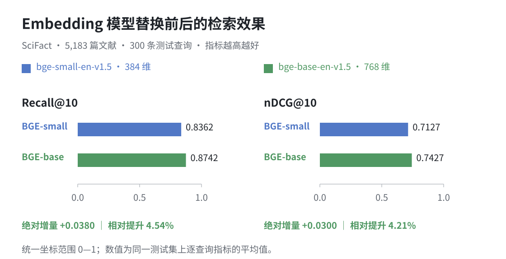

# Switch Embedding Models Smoothly in Milvus

Embedding models affect retrieval quality in RAG, multimodal search, recommendation systems, and other AI applications. As models improve, existing applications often need to upgrade. Changing the query encoder is only part of the work: historical documents must be re-embedded while the retrieval service remains available, with time to evaluate the new model and a way to roll back.

Milvus 3.0 supports adding and dropping vector fields online. Nullable fields allow old and new embeddings to coexist in one collection while the new vectors are being prepared. The service can continue using the old model during backfill and evaluation, gradually move traffic to the new model, and remove the old field after the observation period.

This article follows a knowledge base as it migrates from BGE-small-en-v1.5 to BGE-base-en-v1.5. Figure 1 shows the data changes and rollback paths; the sections follow the same sequence. The experiment uses Milvus 3.0.2, PyMilvus 3.0.2, and the public SciFact dataset, covering ingestion, backfill, evaluation, cutover, rollback, and field cleanup.


<p align="center"><em>Figure 1. The six stages of embedding model migration.</em></p>

## Step 1: Build the retrieval service with the existing model

The experiment uses the BEIR version of [SciFact](https://github.com/beir-cellar/beir): 5,183 scientific documents, 300 test queries, and their relevance judgments. The corpus serves as a document knowledge base for comparing retrieval quality before and after migration.

Each document's title and abstract are joined into one text chunk and stored as one entity. Chunk boundaries and primary keys remain unchanged throughout migration. Both models have a maximum input length of 512 tokens; the tokenizer truncates longer inputs. All reported metrics use this text-processing policy.

| Role | Model | Dimensions |
| --- | --- | --- |
| Existing model | BAAI/bge-small-en-v1.5 | 384 |
| Candidate model | BAAI/bge-base-en-v1.5 | 768 |

<p align="center"><em>Table 1. Models and vector dimensions before and after migration.</em></p>

The experiment uses FastEmbed 0.7.4 with quantized ONNX models on CPU. The different output dimensions demonstrate migration across vector sizes; model selection should be based on evaluation of your own workload.

Prepare a reachable Milvus 3.0.2 instance, clone or download this repository, and run the following commands to execute the complete experiment. Subsequent snippets explain each stage and do not need to be run again afterward. Change `--uri` to connect to another instance.

```shell
uv venv --python 3.12 .venv
uv pip install --python .venv/bin/python -r requirements.lock.txt
HF_HUB_DISABLE_XET=1 .venv/bin/python run_public.py \
  --uri http://localhost:19530 --model-cache ./models
```

The script downloads the dataset and completes the migration in a separate test collection. Use the repository's Docker Compose configuration to deploy a new instance.

Initialize the client and the two FastEmbed models. In the code, `model_a`, `vector_a`, and route value `"A"` refer to BGE-small-en-v1.5; `model_b`, `vector_b`, and route value `"B"` refer to BGE-base-en-v1.5. Subsequent snippets share this `client` and collection `name`.

```python
from fastembed import TextEmbedding
from pymilvus import DataType, MilvusClient

client = MilvusClient(uri="http://localhost:19530")
name = "scifact_model_upgrade"
model_a = TextEmbedding("BAAI/bge-small-en-v1.5", threads=2)
model_b = TextEmbedding("BAAI/bge-base-en-v1.5", threads=2)
```

The initial schema stores the document ID, title, source text, and BGE-small-en-v1.5 vectors in `vector_a`:

| Field | Type | Content |
| --- | --- | --- |
| id | VARCHAR, primary key | SciFact document ID; unchanged during migration |
| title | VARCHAR | Document title returned with search results |
| text | VARCHAR | Title + newline + abstract; the source input for both models |
| vector_a | FLOAT_VECTOR, 384 dimensions | Embeddings generated by BGE-small-en-v1.5 |

<p align="center"><em>Table 2. The initial collection schema.</em></p>

```python
schema = client.create_schema(auto_id=False, enable_dynamic_field=False)
schema.add_field("id", DataType.VARCHAR, max_length=64, is_primary=True)
schema.add_field("title", DataType.VARCHAR, max_length=2048)
schema.add_field("text", DataType.VARCHAR, max_length=65535)
schema.add_field("vector_a", DataType.FLOAT_VECTOR, dim=384)
client.create_collection(name, schema=schema, consistency_level="Strong")
```

`load_data()` downloads the complete corpus from the BEIR distribution. Convert `_id`, `title`, and `text` into entity records, generate embeddings with BGE-small-en-v1.5, and insert them in batches:

```python
from run_public import load_data

docs, queries, qrels = load_data()
rows = [
    {"id": d["_id"], "title": d["title"],
     "text": d["title"] + "\n" + d["text"]}
    for d in docs
]
for start in range(0, len(rows), 32):
    batch = rows[start:start + 32]
    vectors = list(model_a.embed([r["text"] for r in batch]))
    client.insert(name, data=[
        {**r, "vector_a": v.tolist()} for r, v in zip(batch, vectors)
    ])
```

After ingestion, create an HNSW index on `vector_a` and load the collection. The same helper will create the index for `vector_b` later.

```python
def create_vector_index(field):
    params = client.prepare_index_params()
    params.add_index(
        field_name=field, index_name=field + "_hnsw",
        index_type="HNSW", metric_type="COSINE",
        params={"M": 16, "efConstruction": 100},
    )
    client.create_index(name, index_params=params)

client.flush(name)
create_vector_index("vector_a")
client.load_collection(name)
```

The existing model can now serve queries. Requests continue using this configuration while the new vectors are prepared.

## Step 2: Add a vector field for the new model

BGE-small-en-v1.5 produces 384-dimensional vectors; BGE-base-en-v1.5 produces 768-dimensional vectors. The new model therefore needs a separate field and index. Each field has its own dimension and index definition, and `anns_field` selects the target field at search time.

Writing vectors with a different dimension to the original field fails dimension validation. Even when two models use the same dimension, their embedding spaces are generally not directly comparable and should not be mixed in one search space.

Keep `vector_a`, add `vector_b`, and create its index:

```python
client.add_collection_field(
    name, field_name="vector_b",
    data_type=DataType.FLOAT_VECTOR, dim=768, nullable=True,
)
create_vector_index("vector_b")
```

The added field must use `nullable=True` to represent historical records that do not yet have new embeddings. Adding the field does not run model inference; the application computes and writes the vectors. Queries still use BGE-small-en-v1.5 and `vector_a` at this stage.

## Step 3: Re-embed the documents with the new model

Read source text from the Milvus `text` field in batches, generate embeddings with BGE-base-en-v1.5, and write them to `vector_b` by primary key. `partial_update=True` preserves omitted fields, including titles, source text, and old vectors. If the source text is stored elsewhere, retrieve and associate it by primary key:

```python
iterator = client.query_iterator(
    name, filter="", output_fields=["id", "text"],
    batch_size=32, consistency_level="Strong",
)
first_batch = True
try:
    while True:
        batch = iterator.next()
        if not batch:
            break
        vectors = list(model_b.embed([r["text"] for r in batch]))
        client.upsert(name, data=[
            {"id": r["id"], "vector_b": v.tolist()}
            for r, v in zip(batch, vectors)
        ], partial_update=True)
        if first_batch:
            client.flush(name)
            client.load_collection(name, load_fields=[
                "id", "title", "text", "vector_a", "vector_b",
            ])
            client.refresh_load(name)
            first_batch = False
finally:
    iterator.close()
```

This experiment uses a fixed corpus. For a knowledge base with ongoing inserts, updates, and deletes, coordinate source versions and write ordering between backfill and incremental changes. This prevents embeddings generated from older text from overwriting newer vectors or recreating deleted records.

## Step 4: Check the backfill and compare retrieval quality

Before shifting traffic, confirm that historical backfill and any incremental synchronization are complete, the new index is built, the field is loaded, and actual searches succeed. The complete script also checks source text and vectors record by record. Keep using the old model if any check fails.

```python
import time

client.flush(name)
client.refresh_load(name)

deadline = time.monotonic() + 180
while True:
    state = client.describe_index(name, "vector_b_hnsw")
    if (
        state.get("state") == "Finished"
        and state.get("pending_index_rows", 0) == 0
    ):
        break
    if time.monotonic() > deadline:
        raise TimeoutError(str(state))
    time.sleep(1)
```

The first-batch search check confirms that populated records can be retrieved and records with a NULL vector are excluded from searches on that field.

After these checks pass, compare retrieval quality on the same corpus and query set.

The experiment evaluates all 300 SciFact test queries using Recall@10 and nDCG@10. Recall@10 measures the fraction of relevant documents retrieved in the top 10; nDCG@10 also accounts for their ranking positions. Both metrics are averaged across queries.

Each model encodes its own queries and searches the document vectors generated by that same model. This example applies the recommended BGE query instruction, encodes queries with BGE-base-en-v1.5, and searches `vector_b`:

```python
prefix = "Represent this sentence for searching relevant passages: "
query_ids = sorted(qrels, key=int)
query_vectors_b = list(model_b.embed([
    prefix + queries[qid] for qid in query_ids
]))
results_b = client.search(
    name, anns_field="vector_b",
    data=[v.tolist() for v in query_vectors_b], limit=10,
    search_params={"metric_type": "COSINE", "params": {"ef": 128}},
    consistency_level="Strong",
)
```

Encode the same queries with BGE-small-en-v1.5 and search `vector_a` to obtain the pre-migration results. The repository records relevance judgments, retrieved document IDs, and per-query metrics so that improvements and regressions can be examined individually.



<p align="center"><em>Figure 2. Retrieval quality before and after migration on SciFact.</em></p>

| Comparison | Recall@10 | nDCG@10 |
| --- | ---: | ---: |
| Before: BGE-small-en-v1.5, 384 dimensions | 0.8362 | 0.7127 |
| **After: BGE-base-en-v1.5, 768 dimensions** | **0.8742** | **0.7427** |
| Absolute change: after - before | +0.0380 | +0.0300 |
| Relative improvement | +4.54% | +4.21% |

<p align="center"><em>Table 3. Mean retrieval metrics and changes across 300 test queries.</em></p>

Absolute change is calculated as `after - before`; relative improvement is `(after - before) / before`. Calculations use the unrounded metrics. Recall@10 increases by 0.0380, or 3.80 percentage points, and nDCG@10 increases by approximately 0.0300.

At the query level, nDCG@10 improves for 65 queries, remains unchanged for 196, and decreases for 39. A higher average does not imply that every query improves. Review regressions and evaluate canary traffic before completing the cutover.

Both evaluations use the same corpus, queries, text preprocessing, and search parameters. The results reflect the quantized ONNX implementations used in this experiment. They measure retrieval quality rather than generated-answer quality and should not be treated as a model ranking across different datasets or configurations.

## Step 5: Shift traffic gradually and keep rollback available

After offline validation, send a subset of requests to BGE-base-en-v1.5. Observe retrieval quality, latency, and error rates before increasing its traffic share. Retain BGE-small-en-v1.5 inference and up-to-date old-model vectors throughout the observation period.

Bind the model and vector field into one retrieval version, and select that pair when a request starts. Encoding and search then use the same configuration even if the default version changes while the request is running.

```python
routes = {
    "A": (model_a, "vector_a"),
    "B": (model_b, "vector_b"),
}

def search(question, version):
    model, field = routes[version]  # Pin the model and field when the request starts
    vector = next(model.embed([prefix + question])).tolist()
    return client.search(
        name, data=[vector], anns_field=field, limit=10,
        output_fields=["title"],
        search_params={"metric_type": "COSINE", "params": {"ef": 128}},
        consistency_level="Strong",
    )
```

The following commands illustrate the experiment HTTP API; `version="B"` selects BGE-base-en-v1.5. The automated experiment controls routing, so these commands do not need to be executed manually:

```shell
curl http://localhost:8080/search \
  -H 'Content-Type: application/json' \
  -d '{"query":"0-dimensional biomaterials show inductive properties.","version":"B"}'
```

The experiment validates mixed-version routing with 30 requests: 6 use the new model and 24 use the old model. This check is not a real-user evaluation of business impact.

In production, assign traffic consistently by user, tenant, or session. After canary validation, switch the default retrieval version:

```shell
curl http://localhost:8080/route \
  -H 'Content-Type: application/json' -d '{"version":"B"}'
```

If the new version fails quality, latency, or error-rate requirements during the observation period, route subsequent requests back to BGE-small-en-v1.5 while retaining both vector fields. After correcting the issue, repeat Step 4 before attempting another cutover. The rollback request is:

```shell
curl http://localhost:8080/route \
  -H 'Content-Type: application/json' -d '{"version":"A"}'
```

The HTTP server is a local experiment service, binds to loopback, and stops when the script finishes. A production deployment needs authentication, access controls, and a release mechanism for version changes, integrated with the application's existing service management.

## Step 6: Drop the vector field that is no longer needed

After the observation period, confirm that rollback is no longer needed, route all requests to the new model, stop old-vector writes, and wait for old-version requests to finish before dropping `vector_a`. Once it is deleted, changing the route alone cannot restore the old retrieval version.

This experiment uses low-concurrency requests and a fixed observation interval. Production deployments should use request accounting or a draining mechanism to confirm that old-version requests have completed.

```python
client.drop_collection_field(name, field_name="vector_a")
print(client.describe_collection(name))
print(client.list_indexes(name))
```

In this experiment, dropping `vector_a` also removes its associated index. The primary key, title, source text, and `vector_b` remain available. New records containing only BGE-base-en-v1.5 vectors can still be inserted and searched. Physical object-storage space is reclaimed later by background processes.

During migration, reserve resources for both vector fields and indexes, and account for the additional model inference cost.

## Summary

Milvus 3.0 supports a staged model migration through online field additions and removals. The old model keeps serving while new embeddings are backfilled and evaluated. Switch the query model and vector field together, retain and update the old vectors during the rollback window, and drop the old field once rollback is no longer needed.

In this SciFact experiment, switching to BGE-base-en-v1.5 increased Recall@10 from 0.8362 to 0.8742. The complete code and reproduction instructions are available in the [GitHub repository](https://github.com/JackLCL/milvus-embedding-model-migration).

## References

- [BEIR and the SciFact retrieval dataset](https://github.com/beir-cellar/beir)
- [BGE models and query instructions](https://huggingface.co/BAAI/bge-base-en-v1.5)
- [Milvus collection schema changes](https://milvus.io/docs/add-fields-to-an-existing-collection.md)
- [Milvus partial updates](https://milvus.io/docs/upsert-entities.md)

Version scope: the code and recorded results use Milvus 3.0.2 and PyMilvus 3.0.2. For other releases, consult the corresponding version's documentation for field-change APIs and constraints.
