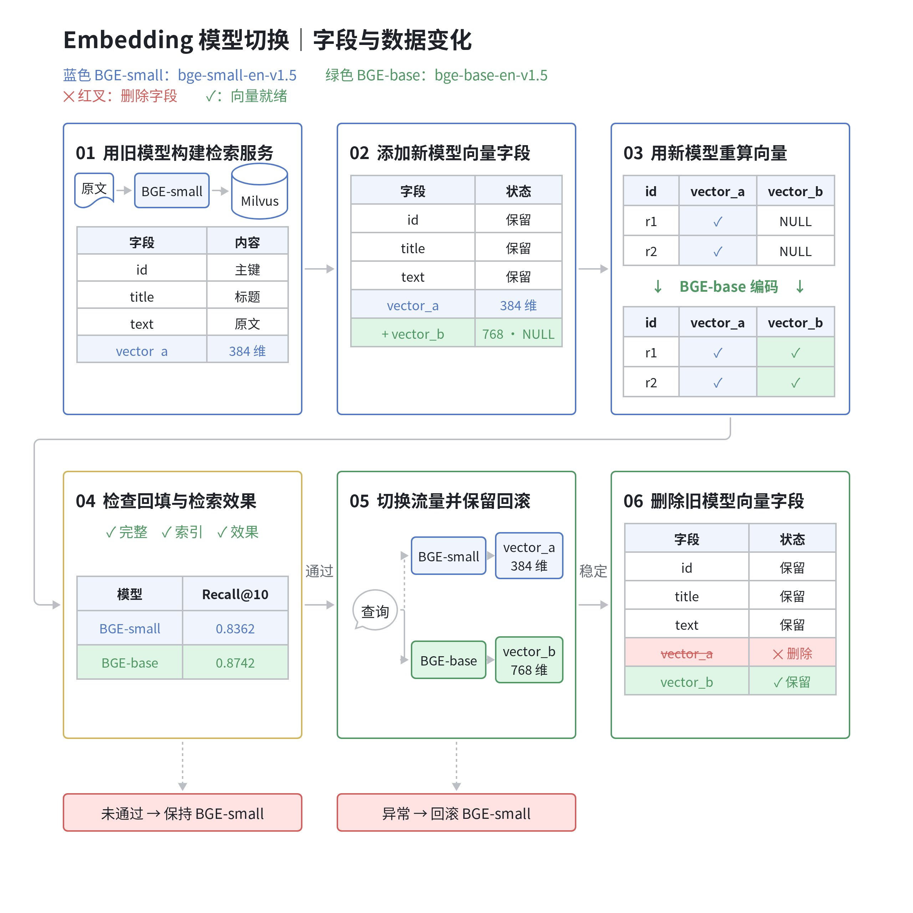

# 如何在 Milvus 中平滑切换 Embedding 模型

Embedding 模型是影响 RAG、多模态搜索、推荐系统等 AI 应用召回质量的重要因素。随着模型能力演进，已有系统经常需要升级 Embedding 模型来提升业务效果。但模型升级并不只是更换查询端的配置：历史数据需要重新向量化，迁移期间还要维持检索服务，并为新模型的效果验证和回滚留出空间。

在最新的 Milvus3.0 版本中，得益于灵活的加减列、默认值和空值的能力，使新旧模型的向量能够在同一 Collection 中共存，系统可以在旧模型继续服务的同时完成新向量回填和效果验证，再逐步切换流量，最后清理旧字段，完成Embeding 模型的平滑切换。

本文以一个知识库系统为例，将其中的 Embeding 模型从 BGE-small-en-v1.5 切换至 BGE-base-en-v1.5。图 1 展示了切换过程中各个阶段的数据变化与回滚路径，后续章节按此流程展开。以下实验基于 Milvus 3.0.2、PyMilvus 3.0.2 和公开数据集 SciFact，覆盖数据入库、向量回填、检索评测、切换、回滚及旧字段清理。文末提供完整代码和运行结果。



<p align="center"><em>图 1｜Embedding 模型迁移的六个阶段</em></p>

## Step 1：用旧模型构建检索服务

实验采用 BEIR 中的 [SciFact 数据集](https://github.com/beir-cellar/beir)，包含 5,183 篇科学文献，以及 300 条测试查询和对应的相关性标注，用于构建文献知识库并比较迁移前后的检索效果。

为控制实验变量，每篇文献的标题与摘要拼接为一个文本片段，对应一条实体记录（Entity）。迁移期间保持分块方式和主键不变。两个模型的最大输入长度均为 512 tokens，超出部分由分词器截断；本文指标均基于这一文本处理方式。

| 角色 | 模型 | 输出维度 |
| --- | --- | --- |
| 当前线上模型 | BAAI/bge-small-en-v1.5 | 384 |
| 待验证模型 | BAAI/bge-base-en-v1.5 | 768 |

<p align="center"><em>表 1｜迁移前后的 Embedding 模型与向量维度</em></p>

本例选用两个支持 CPU 推理且输出维度不同的模型，以验证不同维度之间的迁移流程。实际模型选型应以目标业务的评测结果为依据；使用其他模型时，还需相应调整向量维度、文本预处理和索引配置。

准备可连接的 Milvus 3.0.2 实例，下载并解压文末代码包后，执行以下命令。示例使用本机地址 `localhost:19530`，连接其他实例时替换 `--uri` 参数：

```shell
uv venv --python 3.12 .venv
uv pip install --python .venv/bin/python -r requirements.lock.txt
HF_HUB_DISABLE_XET=1 .venv/bin/python run_public.py \
  --uri http://localhost:19530 --model-cache ./models
```

脚本自动下载 SciFact，创建带时间戳的独立 Collection，并执行入库、回填、评测、切换和回滚。已有 Milvus 实例可通过参数指定连接地址；新建环境可使用附件中的 Docker Compose 配置部署 Milvus 3.0.2。

首先初始化 Milvus 客户端和两个 FastEmbed 模型。代码中，`model_a`、`vector_a` 和路由值 `"A"` 对应 BGE-small-en-v1.5；`model_b`、`vector_b` 和路由值 `"B"` 对应 BGE-base-en-v1.5。后续示例共用此处的 `client` 与 Collection 名称 `name`：

```python
from fastembed import TextEmbedding
from pymilvus import DataType, MilvusClient

client = MilvusClient(uri="http://localhost:19530")
name = "scifact_model_upgrade"
model_a = TextEmbedding("BAAI/bge-small-en-v1.5", threads=2)
model_b = TextEmbedding("BAAI/bge-base-en-v1.5", threads=2)
```

初始集合结构（Schema）包含文献主键、标题、原始文本，以及 BGE-small-en-v1.5 对应的向量字段 `vector_a`：

| 字段 | 类型 | 内容 |
| --- | --- | --- |
| id | VARCHAR，主键 | SciFact 文献 ID，迁移前后保持一致 |
| title | VARCHAR | 文献标题，用于返回检索结果 |
| text | VARCHAR | 标题 + 换行 + 摘要，也是生成向量的原始输入 |
| vector_a | FLOAT_VECTOR，384 维 | BGE-small-en-v1.5 生成的向量 |

<p align="center"><em>表 2｜初始 Collection 的字段定义</em></p>

```python
schema = client.create_schema(auto_id=False, enable_dynamic_field=False)
schema.add_field("id", DataType.VARCHAR, max_length=64, is_primary=True)
schema.add_field("title", DataType.VARCHAR, max_length=2048)
schema.add_field("text", DataType.VARCHAR, max_length=65535)
schema.add_field("vector_a", DataType.FLOAT_VECTOR, dim=384)
client.create_collection(name, schema=schema, consistency_level="Strong")
```

`load_data()` 从 BEIR 官方下载地址加载完整语料。将文献的 `_id`、`title`、`text` 转换为实体记录后，使用 BGE-small-en-v1.5 生成向量，并分批写入 Milvus：

```python
from run_public import load_data

docs, queries, qrels = load_data()
rows = [
    {"id": d["_id"], "title": d["title"],
     "text": d["title"] + "\n" + d["text"]}
    for d in docs
]
for start in range(0, len(rows), 32):
    batch = rows[start:start + 32]
    vectors = list(model_a.embed([r["text"] for r in batch]))
    client.insert(name, data=[
        {**r, "vector_a": v.tolist()} for r, v in zip(batch, vectors)
    ])
```

向量写入后，为 `vector_a` 创建 HNSW 索引并加载 Collection。索引创建函数也用于后续的 `vector_b` 字段：

```python
def create_vector_index(field):
    params = client.prepare_index_params()
    params.add_index(
        field_name=field, index_name=field + "_hnsw",
        index_type="HNSW", metric_type="COSINE",
        params={"M": 16, "efConstruction": 100},
    )
    client.create_index(name, index_params=params)

client.flush(name)
create_vector_index("vector_a")
client.load_collection(name)
```

至此，BGE-small-en-v1.5 与 `vector_a` 构成可用的检索基线。接下来的字段新增、向量回填和离线评测期间，查询继续使用这套配置。

## Step  2：为新模型添加向量字段

BGE-small-en-v1.5 输出 384 维向量，BGE-base-en-v1.5 输出 768 维向量，因此需要为新模型增加独立的向量字段和索引。两个字段分别定义维度和索引，检索时通过 `anns_field` 指定目标字段。

将不同维度的新向量写入原字段会触发维度校验错误。即使维度相同，不同模型生成的向量通常也不具备直接比较的语义基础，因此不应在同一检索空间中混用。

本例保留 `vector_a`，新增 `vector_b` 并创建索引：

```python
client.add_collection_field(
    name, field_name="vector_b",
    data_type=DataType.FLOAT_VECTOR, dim=768, nullable=True,
)
create_vector_index("vector_b")
```

新增字段必须设置 `nullable=True`，以表示历史记录尚未生成的新向量。字段创建操作本身不触发 Embedding 推理，新向量需要由应用计算并写入。此阶段的查询仍由 BGE-small-en-v1.5 和 `vector_a` 处理。

## Step  3：用新模型重新生成文档向量

新字段创建后，使用 BGE-base-en-v1.5 重新编码历史文献，将结果写入 `vector_b`。回填读取 Milvus 中已保存的 `text`，保持原文、分块方式和主键映射一致，并保留 `vector_a` 供原有检索服务使用。

若 Collection 未保存原文，则需要从对象存储或业务数据库读取对应文本，并按主键关联。旧向量不能作为恢复原始文本并重新执行 Embedding 的可靠数据源。

以下代码通过 Query Iterator 分批读取 `id` 和 `text`，使用 BGE-base-en-v1.5 生成向量，再按主键执行部分更新。设置 `partial_update=True` 可保留未提交的正文、标题和旧向量字段：

```python
iterator = client.query_iterator(
    name, filter="", output_fields=["id", "text"],
    batch_size=32, consistency_level="Strong",
)
first_batch = True
try:
    while True:
        batch = iterator.next()
        if not batch:
            break
        vectors = list(model_b.embed([r["text"] for r in batch]))
        client.upsert(name, data=[
            {"id": r["id"], "vector_b": v.tolist()}
            for r, v in zip(batch, vectors)
        ], partial_update=True)
        if first_batch:
            client.flush(name)
            client.load_collection(name, load_fields=[
                "id", "title", "text", "vector_a", "vector_b",
            ])
            client.refresh_load(name)
            first_batch = False
finally:
    iterator.close()
```

本实验使用固定公开语料，回填期间不修改文档内容。对于持续发生增删改的生产知识库，需要在迁移期间维护两套向量，并通过源数据版本或按主键协调写入顺序，防止过期回填覆盖新内容，或重新写入已删除记录。部分更新接口不能替代应用对内容版本和删除事件的管理。

## Step 4：检查回填结果，对比检索效果

切换流量前，需要确认历史回填已完成、新索引已构建、目标字段已加载，并通过实际检索验证可用性。存在增量数据时，还需确认增量同步已完成。以下代码刷新加载并查看索引状态；复现脚本同时逐条核对原文与向量。

```python
client.flush(name)
client.refresh_load(name)
print(client.describe_index(name, "vector_b_hnsw"))
```

首批回填后的检索检查表明，已回填的记录可以被召回，向量值为 NULL 的记录不参与该字段的检索。查询向量的维度必须与目标字段一致：`vector_a` 使用 384 维向量，`vector_b` 使用 768 维向量。

确认数据和索引就绪后，使用相同的语料与查询集比较两个模型的检索效果。数据完整性、加载状态和效果指标均满足要求后，才能进入灰度切换；否则继续使用 BGE-small-en-v1.5。

本实验使用 SciFact 的全部 300 条测试查询，比较 Recall@10 和 nDCG@10。Recall@10 衡量前 10 条结果对相关文献的覆盖比例；nDCG@10 进一步考虑相关文献的排序位置。两个指标均对测试查询取平均。

评测时，每个模型分别编码查询文本，并检索由自身生成的文档向量。以下代码采用 BGE 推荐的查询指令格式，通过 BGE-base-en-v1.5 编码查询，再检索 `vector_b`：

```python
prefix = "Represent this sentence for searching relevant passages: "
query_ids = sorted(qrels, key=int)
query_vectors_b = list(model_b.embed([
    prefix + queries[qid] for qid in query_ids
]))
results_b = client.search(
    name, anns_field="vector_b",
    data=[v.tolist() for v in query_vectors_b], limit=10,
    search_params={"metric_type": "COSINE", "params": {"ef": 128}},
    consistency_level="Strong",
)
```

使用 BGE-small-en-v1.5 编码同一组查询并检索 `vector_a`，即可得到替换前的评测结果。代码包保存了逐查询的相关文献标注、召回文献 ID 和指标，可据此分析具体查询的改善与退化。

### 替换前后的效果对比


<p align="center"><em>图 2｜模型替换前后的检索效果（SciFact）</em></p>

| **对比项** | **Recall@10** | **nDCG@10** |
| --- | --- | --- |
| 替换前 BGE-small-en-v1.5（384 维） | 0.8362 | 0.7127 |
| **替换后 BGE-base-en-v1.5（768 维）** | **0.8742** | **0.7427** |
| 绝对增量（替换后 − 替换前） | +0.0380 | +0.0300 |
| 相对提升 | +4.54% | +4.21% |

<p align="center"><em>表 3｜300 条测试查询的平均检索指标与增量</em></p>

绝对增量按“替换后 − 替换前”计算，相对提升按“（替换后 − 替换前）/ 替换前”计算，均使用未舍入的原始指标值。Recall@10 的绝对增量为 0.0380，即提高 3.80 个百分点；nDCG@10 的绝对增量约为 0.0300。

逐查询统计显示，nDCG@10 在 65 条查询上提升、196 条上保持不变、39 条上下降。平均指标提升并不意味着所有查询均得到改善，正式切换前仍应检查退化样例并完成业务灰度验证。

本对比使用相同的语料、查询集、文本处理方式和检索参数，两套模型分别编码各自的查询与文档。图表反映本次量化 ONNX 实现下的检索效果，不直接代表最终生成答案的质量，也不应直接用于跨数据集或跨配置的模型排名比较。

## Step  5：逐步切换流量，保留回滚能力

离线验证通过后，先将部分请求交给 BGE-base-en-v1.5，观察检索质量、延迟和错误率，再逐步扩大流量比例。观察期内保留 BGE-small-en-v1.5 的推理能力和最新向量，以支持回滚。

将模型与目标字段绑定为一个检索版本，并在请求进入时固定该配置。随后，向量生成和检索均使用同一版本；即使默认版本在请求执行期间发生变化，也不影响当前请求的配置。

```python
routes = {
    "A": (model_a, "vector_a"),
    "B": (model_b, "vector_b"),
}

def search(question, version):
    model, field = routes[version]  # 请求开始时固定这一对配置
    vector = next(model.embed([prefix + question])).tolist()
    return client.search(
        name, data=[vector], anns_field=field, limit=10,
        output_fields=["title"],
        search_params={"metric_type": "COSINE", "params": {"ef": 128}},
        consistency_level="Strong",
    )
```

复现脚本提供 HTTP 检索接口，接收查询文本，在服务内生成向量并调用 Milvus。以下请求通过 `version="B"` 选择 BGE-base-en-v1.5：

```shell
curl http://localhost:8080/search \
  -H 'Content-Type: application/json' \
  -d '{"query":"0-dimensional biomaterials show inductive properties.","version":"B"}'
```

本实验发送了 30 个混合版本请求，其中 6 个使用 BGE-base-en-v1.5，24 个使用 BGE-small-en-v1.5，验证每个请求均使用对应的模型和向量字段。这项检查验证路由行为，业务效果仍需通过真实流量的对照实验评估。

生产环境应按用户、租户或会话等维度稳定分流，并持续观察检索质量、延迟和错误率。灰度验证完成后，可切换默认版本：

```shell
curl http://localhost:8080/route \
  -H 'Content-Type: application/json' -d '{"version":"B"}'
```

若观察期内新版本的检索效果、延迟或错误率未达到要求，可将后续请求切回 BGE-small-en-v1.5，并保留两列向量。修正问题后，重新执行阶段 4 的验证，再尝试切换。回滚请求如下：

```shell
curl http://localhost:8080/route \
  -H 'Content-Type: application/json' -d '{"version":"A"}'
```

本地 HTTP 服务仅用于实验，绑定本机地址并随实验结束关闭。生产部署需为版本切换配置鉴权、访问控制和发布机制，并接入既有的服务治理体系。

## Step  6：删除不再使用的旧向量字段

观察期结束后，只有确认不再需要回滚至 BGE-small-en-v1.5，才能删除旧向量字段。删除后，服务仅保留 BGE-base-en-v1.5 检索链路，无法再通过切换路由立即恢复旧版本。

清理前，将全部请求路由至 BGE-base-en-v1.5，停止 BGE-small-en-v1.5 的向量写入，并等待使用旧模型的在途请求完成，随后删除 `vector_a`：

```python
client.drop_collection_field(name, field_name="vector_a")
print(client.describe_collection(name))
print(client.list_indexes(name))
```

本次实验中，删除 `vector_a` 后，其关联索引也被移除，`vector_b` 及文献主键、标题和正文均保留。仅写入 BGE-base-en-v1.5 向量的新记录仍可正常检索。字段删除后，对象存储中的物理空间由后续后台过程回收。

双向量列方案将历史数据重算与在线请求切换分离：后台完成回填和效果验证，查询端在新版本就绪后切换，并在观察期内保留回滚路径。迁移期间仍需承担额外推理成本，并为两套向量及索引预留存储和运行资源。

## 实验结果与复现说明

本次实验完成了 5,183 篇文献的入库与向量回填，并使用 300 条测试查询评估检索效果。回填后的逐条核对确认：主键、标题、正文和原有向量保持一致，新模型向量完整写入。

迁移流程通过了 16 项检查，覆盖回填完整性、版本切换与回滚、观察期双写更新、旧字段删除和删除后的新记录写入。持续发送的 3,754 个 HTTP 检索请求均包含 Embedding 推理，未记录到失败；另有 30 个请求用于验证混合版本路由。

验证范围为单进程、低并发下的迁移流程，不包含真实用户 A/B 实验或集群故障测试。公开语料在评测期间保持不变；增量写入验证使用独立测试记录，并在验证结束后删除，以避免影响模型对比结果。

文末代码包包含固定依赖、Docker Compose 配置、数据下载逻辑、完整实验脚本、逐查询检索结果、运行摘要和图表源文件。按 `README.md` 可复现上述流程。脚本创建独立的测试 Collection，不修改已有业务集合。

实验采用 FastEmbed 的量化 ONNX 实现、固定文本处理方式和 HNSW 参数。指标仅反映本次数据与配置下的表现；实际部署应结合目标业务数据重新评测。

## 参考资料

- [BEIR 与 SciFact 数据集](https://github.com/beir-cellar/beir)

- [BGE 模型与查询指令](https://huggingface.co/BAAI/bge-base-en-v1.5)

- [Milvus 字段变更](https://milvus.io/docs/add-fields-to-an-existing-collection.md)

- [Milvus 部分更新](https://milvus.io/docs/upsert-entities.md)

版本说明：本文代码和实验结果基于 Milvus 3.0.2 与 PyMilvus 3.0.2。其他版本的字段变更接口与约束，以对应版本的官方文档为准。
