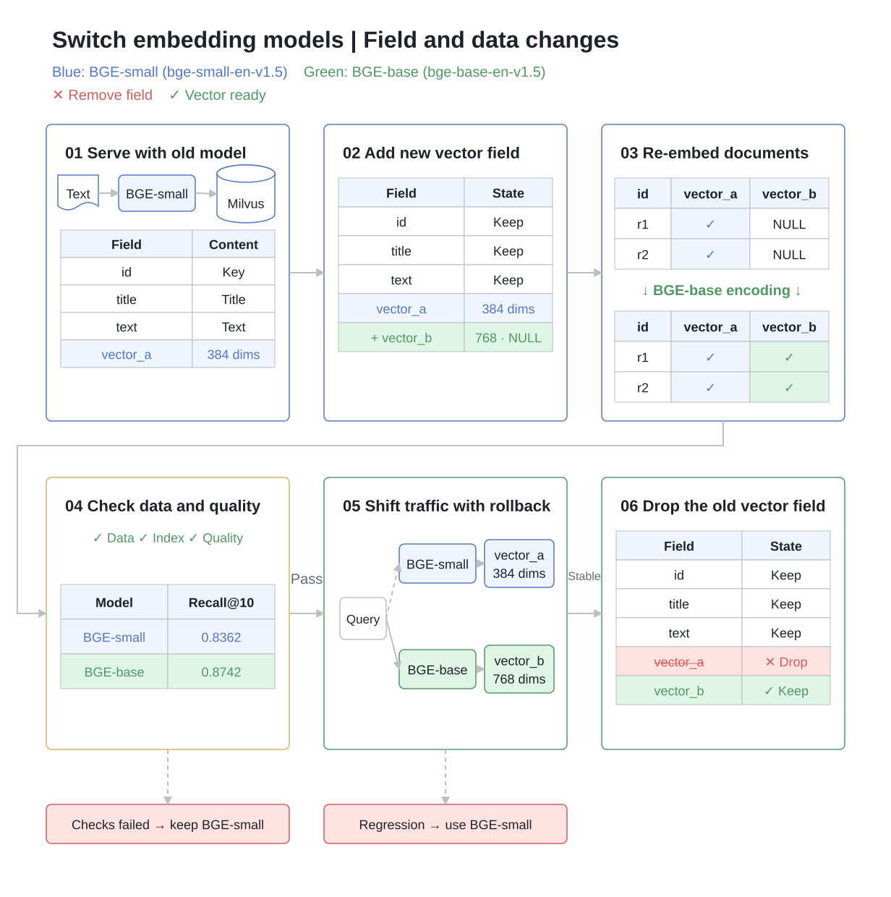

# Embedding Model Migration in Milvus 3.0.2

An end-to-end SciFact experiment that migrates from **BAAI/bge-small-en-v1.5 (384 dimensions)** to **BAAI/bge-base-en-v1.5 (768 dimensions)** while retaining the old retrieval version during backfill, evaluation, and the rollback window.

[Read the article](ARTICLE.md) · [Recorded results](RESULTS.md) · [Data and model sources](THIRD_PARTY_NOTICES.md) · [Execution validation](VALIDATION.md)



## Get the code

```bash
git clone https://github.com/JackLCL/milvus-embedding-model-migration.git
cd milvus-embedding-model-migration
```

## Requirements

- `uv` for a Python 3.12 environment. Docker Compose is optional if a Milvus 3.0.2 instance is already available.
- Network access to the BEIR dataset distribution and Hugging Face model repositories on the first run.
- At least 8 available CPU threads are recommended. The script uses four inference workers with two threads per ONNX session.
- The complete SciFact retrieval dataset: 5,183 documents and 300 BEIR test queries. Each document is one entity with `text = title + "\n" + abstract`. Models process at most 512 tokens. All vectors are generated by model inference.

## Start Milvus

Skip this section if you already have a Milvus 3.0.2 instance.

```bash
mkdir -p volumes/milvus
docker run --rm --user 0:0 --entrypoint chown \
  -v "$PWD/volumes/milvus:/var/lib/milvus" \
  milvusdb/milvus:v3.0.2 999:999 /var/lib/milvus
docker compose up -d
curl -f http://localhost:9091/healthz
```

The Milvus container runs as UID/GID 999, so the data directory must have suitable ownership. Wait for the Compose health checks to pass before running the experiment. Compose uses a dedicated project name, network, and data directories, with the Milvus API bound to `localhost:19530`. Adjust port mappings for your environment if needed.

MinIO uses the public local-demo credentials `minioadmin`. This example does not configure production authentication; Milvus ports are published only on the loopback interface.

## Run the experiment

```bash
uv venv --python 3.12 .venv
uv pip install --python .venv/bin/python -r requirements.lock.txt
HF_HUB_DISABLE_XET=1 .venv/bin/python -u run_public.py \
  --uri http://localhost:19530 --model-cache ./models
```

The script starts an HTTP search service at `localhost:8080`, accepts query text, runs embedding inference, and calls Milvus. It ingests BGE-small vectors, adds the new field, reads source text from Milvus to backfill BGE-base vectors, evaluates retrieval, exercises canary routing and rollback, and drops the old field.

While the script is running, `/search` uses the current default retrieval version. An explicit BGE-base request is accepted only after that version is ready.

```bash
curl http://localhost:8080/search -H 'Content-Type: application/json' \
  -d '{"query":"0-dimensional biomaterials show inductive properties."}'
```

`/route` changes the default version. The automated experiment controls this route; manual changes during validation can interfere with its sequence. The local server has no authentication, binds to loopback, and shuts down when the script exits.

## Check the outcome

- The process exits with status `0`.
- `artifacts/LATEST_SUCCESS` identifies the successful run directory.
- `artifacts/<run>/summary.json` contains `"success": true`.
- Each run uses a separate timestamped collection and does not delete existing application collections.

The run directory contains schema snapshots, model metrics, per-query relevant and retrieved IDs, HTTP request records, canary assignments, and a copy of the executed script. Dependencies are pinned in `requirements.lock.txt`; the dataset SHA-256 is recorded in `provenance.json`.

## Models and evaluation settings

- BGE-small: `BAAI/bge-small-en-v1.5`, 384 dimensions.
- BGE-base: `BAAI/bge-base-en-v1.5`, 768 dimensions.
- FastEmbed 0.7.4, quantized ONNX models, CPU inference.
- Queries use the prefix `Represent this sentence for searching relevant passages: `; documents do not.
- HNSW: `M=16`, `efConstruction=100`, COSINE; search `ef=128`, top 10, Strong consistency.
- Recall@10 and nDCG@10 are averaged across all 300 test queries. nDCG uses `(2^rel - 1)/log2(rank+1)`; the effective relevance labels are binary.
- Evaluation uses a fixed public corpus. Update checks run afterward with separate probe records that are deleted when the checks finish.
- Every HTTP search performs embedding inference. Recorded latency includes inference, queueing, HTTP communication, and Milvus search.

## Scope and limitations

This experiment validates a single-process workflow under low concurrency. Its request success rate is not a production availability guarantee. Each request pins its model and vector field; production deployments also need configuration management, authentication, canary rollout, and in-flight request draining. Continuously changing sources require coordination between backfill and incremental writes, including version ordering and deletion events.

The experiment uses upstream ONNX weights. Compare repository revisions and hashes with the recorded model provenance when downloading again. Retaining two vector representations and their indexes increases storage, memory, CPU, and inference costs during migration.

## Data and licenses

The script downloads [BEIR SciFact](https://public.ukp.informatik.tu-darmstadt.de/thakur/BEIR/datasets/scifact.zip). See [BEIR](https://github.com/beir-cellar/beir) and the [original SciFact project](https://github.com/allenai/scifact).

This repository does not include the complete document corpus or model weights. `recorded-results/` contains metrics, retrieved IDs, public query text, relevance judgments, and a small number of document titles. Sources and upstream license notices are documented in [THIRD_PARTY_NOTICES.md](THIRD_PARTY_NOTICES.md).

## Code layout

The article shows the same Milvus APIs, text construction, model calls, and routing logic as the executable experiment. The full script additionally includes four CPU inference workers, the HTTP server, phase logs, record-by-record audits, metric calculations, and a dimension-mismatch check. Reproduction requires field creation and backfill, index construction and loading, and coordinated selection of the query model and target field.

The workflow serves BGE-small, issues mixed-version requests, switches to BGE-base, rolls back to BGE-small, switches again, and removes the old vector field. HTTP examples are in `recorded-results/http_example_A.json` and `recorded-results/http_example_B.json`.

## Recorded provenance

Dataset archive SHA-256 for the recorded run:

```text
536e14446a0ba56ed1398ab1055f39fe852686ecad24a6306c80c490fa8e0165
```

`recorded-results/model-provenance.json` records the Hugging Face repositories, revisions, file sizes, and SHA-256 hashes of both ONNX models.

## Connection settings

Connections default to localhost. Compose publishes ports `19530` and `9091`; the HTTP search service uses `8080`. Use command-line arguments to connect to an existing instance, and update client connection settings if Compose port mappings change.

## Diagram sources

The workflow and comparison charts are supplied as English SVGs and PNG previews. Editable native whiteboard node definitions are included for Feishu/Lark.

```bash
node diagrams/build_native_board.cjs
node diagrams/build_comparison_board.cjs
```

The first command regenerates `diagrams/overview.svg` and `diagrams/native-overview-nodes.json`. The second regenerates `diagrams/comparison.svg` and `diagrams/comparison-native-nodes.json`. `diagrams/comparison-metrics.json` contains the measured metrics, absolute changes, relative improvements, and per-query change counts.

## Verify the metrics

After completing an experiment, independently recompute its metrics against the downloaded official relevance judgments:

```bash
.venv/bin/python verify_metrics.py
```

`recorded-results/` preserves the fixed run reported in the article. Generated `artifacts/`, downloaded models, database files, and local environment settings are excluded by `.gitignore`.
